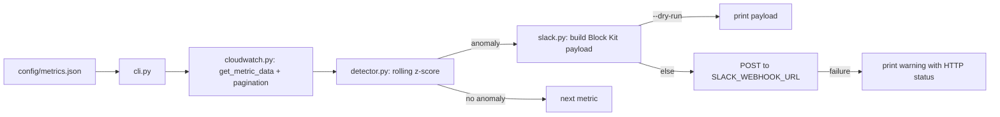

# metric-anomaly-alerts

A Python CLI that pulls metrics from CloudWatch, flags anomalies with a rolling z-score, and
posts a rich Slack alert - current value, expected range, and a recommended action - for each
one that trips its configured threshold.

**Scope.** CloudWatch only. Azure Monitor and GCP Monitoring are explicitly out of scope for
this build; `cloudwatch.py` is kept small and isolated behind a `fetch_metric_values(client,
metric_cfg)` shape specifically so another provider could be added later without touching the
detector or the Slack code. No live CloudWatch call and no real Slack post have been exercised -
see Status below.

## Architecture



## Exit codes

| Code | Meaning |
|---|---|
| 0 | no anomalies found |
| 2 | at least one anomaly found |
| 1 | error (bad config path, invalid JSON, CloudWatch/network failure) |

A failed Slack post never changes the exit code away from 2 - the anomaly happened whether or
not anyone got told about it.

## Prerequisites

- Python 3.12+
- `pip install -r requirements.txt` (`boto3` only)
- AWS credentials with `cloudwatch:GetMetricData` on whatever metrics are configured, available
  the normal `boto3` way (environment variables, a profile, an instance/task role).
- A Slack incoming webhook URL, if you want real posts (not needed for `--dry-run`).

## Usage

```bash
# dry run: print what would be posted, never calls Slack
python cli.py config/metrics.example.json --dry-run

# real run: posts anomalies to Slack
export SLACK_WEBHOOK_URL=https://hooks.example.com/services/T000/B000/REPLACE_ME
python cli.py config/metrics.example.json --region us-east-1
```

## Config format

`config/metrics.example.json` is a list of metric watches:

```json
{
  "namespace": "AWS/EC2",
  "metric_name": "CPUUtilization",
  "dimensions": { "InstanceId": "i-0123456789abcdef0" },
  "stat": "Average",
  "period_seconds": 300,
  "window_seconds": 3600,
  "z_score_threshold": 3.0,
  "recommended_action": "Check for a runaway process or an unexpected traffic spike; consider scaling the instance group."
}
```

- `window_seconds` / `period_seconds` control how far back data is pulled and at what
  resolution.
- `z_score_threshold` is how many standard deviations from the mean of the window counts as an
  anomaly.
- `recommended_action` is free text, included verbatim in the Slack message.

## Detector

`detector.detect(window, threshold)` takes the ordered list of values for a metric (oldest
first) and judges the last one against the mean/stdev of everything before it:

- Fewer than 3 points total (2 history + 1 current), or an empty window: returns "not an
  anomaly" rather than raising - a thin window is normal right after startup.
- Zero variance in the history (every prior point identical): flags an anomaly only if the
  current value differs from that constant, since a z-score can't be computed from a stdev of 0.
- Otherwise: standard z-score, `|z| >= threshold` is an anomaly. The result carries `value`,
  `mean`, `stdev`, `z_score`, and the expected `(low, high)` range, not just a boolean.

## Security considerations

- The Slack webhook URL comes from the `SLACK_WEBHOOK_URL` environment variable and is never
  logged or printed on any path, including failures - only the HTTP status (or connection
  error) is printed.
- No example, default, or test fixture uses a real AWS account ID, ARN, or Slack URL -
  `123456789012`-style account IDs and `example.com`/`hooks.example.com` placeholders only.
- AWS credentials are whatever `boto3`'s normal credential chain finds - this script never reads
  or accepts a credential directly.

## Idempotency

Each run is read-only against CloudWatch and only ever adds a new Slack message - it never
mutates a metric, an alarm, or a prior alert. Running the same config twice in a row produces
the same detection result for the same underlying data (the z-score calculation is a pure
function of the window) and, if still anomalous, a second Slack post - there is no
de-duplication of repeated alerts across runs.

## Tests

```bash
pip install -r requirements-test.txt
ruff check .
ruff format --check .
python -m unittest discover -s tests
```

All tests use hand-written fakes, not `moto` - this only needs `get_metric_data`'s specific
response shape and `NextToken` pagination, which a small fake class covers directly. Coverage:

- `test_detector.py` - spike detection, a flat series and a noisy series both staying under
  threshold, a noisy series still catching a real outlier, too-few-points, an empty window, and
  zero-variance both unchanged (not an anomaly) and changed (is an anomaly).
- `test_cloudwatch.py` - the request built from a metric config (namespace, metric name,
  dimensions, period, stat), a config with no dimensions, values returned oldest-first, and
  `NextToken` pagination followed across two pages.
- `test_slack.py` - the Block Kit payload shape and content, a successful post, an HTTP error,
  a connection error, a missing webhook env var, and that the webhook URL itself never appears
  in any printed output, including on failure.
- `test_cli.py` - config loading, the end-to-end run with fakes for both no-anomaly and
  anomaly cases, `--dry-run` never calling the post function, a failed Slack post not hiding the
  anomaly exit code, a mix of anomalous and clean metrics in one run, and the two error exit
  paths (missing config file, invalid JSON).

## Status

Never run against real CloudWatch and never posted to a real Slack webhook. Validated only with
`ruff`, `ruff format --check`, and the hand-written-fake test suite above. The live CloudWatch
`get_metric_data` call and the real Slack `POST` have both never been exercised end to end.

## Known limits

- CloudWatch only; Azure Monitor and GCP Monitoring are not implemented, only left as an
  extension point behind the same adapter shape.
- No de-duplication of repeated alerts across runs - if a metric stays anomalous across several
  scheduled runs, it posts again every time.
- No retry on a failed Slack post - it warns once and moves on to the next metric.
